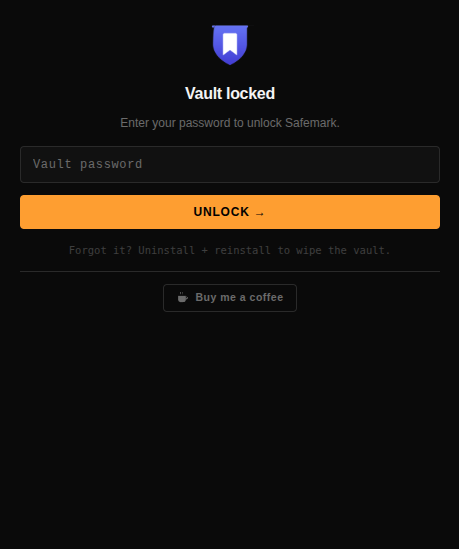
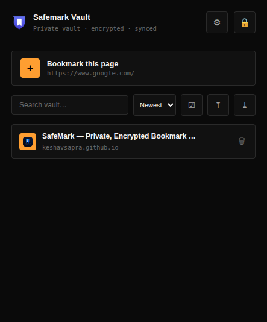
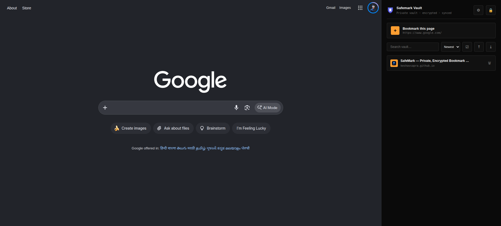

<div align="center">


# SafeMark

**Private bookmarks, sealed with math.**

A Chrome & Brave extension that locks your bookmark vault behind AES-256-GCM encryption.  
No account. No server. No telemetry. Only you hold the key.

[](https://github.com/keshavsapra/SafeMark/releases/latest)
[](LICENSE)
[](https://github.com/keshavsapra/SafeMark)

[**Download**](https://github.com/keshavsapra/SafeMark/releases/latest/download/SafeMark.zip) · [**Website**](https://keshavsapra.github.io/SafeMark/) · [**Releases**](https://github.com/keshavsapra/SafeMark/releases)

</div>

---

## Screenshots

<div align="center">

| Lock screen | Vault | Side panel in Chrome |
|:-----------:|:-----:|:--------------------:|
|  |  |  |

</div>

---

## Why SafeMark?

Standard bookmarks sit in your browser profile as **plaintext** — anyone with file access, a rogue extension, or a stolen disk reads the whole list in seconds.

SafeMark encrypts every byte before it touches storage. What ends up on disk is mathematically useless without your password:

```
// What anyone with file access finds in SafeMark:
"smVault0": "8kDXqzWf2nTvM0ytBv9rQeYwNp1aGhLxIoPZjKsUmCnWdFlR…"
"smVault1": "J6rQeYwNp1aGhLxIoPZjKsUmCnWdFlReT3bY7vXqA2gMoNkW…"
"smHash":   "tude9lejfKy7EX8lCzp5mHf2QrJwVnD4siBxAo6TkGu8yZPl…"
```

---

## Features

| | Feature | Detail |
|--|---------|--------|
| 🔐 | **AES-256-GCM encryption** | Every byte sealed before touching disk — vault is ciphertext only |
| 🧬 | **600k PBKDF2-SHA256** | Key stretched 600,000 iterations — brute-force is computationally infeasible |
| 🚫 | **Zero knowledge** | No backend, no analytics, nothing phones home — 100% auditable |
| 🛡️ | **Brute-force lockout** | Exponential backoff after failed attempts (up to 60s delay) |
| 🪟 | **Docked side panel** | Vault lives beside your browser — one click to save the active tab |
| ☁️ | **Encrypted cross-device sync** | Ciphertext chunks via Chrome/Brave Sync — password never syncs |
| 📤 | **Export / Import** | Standard Netscape HTML format — never locked in |
| 🏷️ | **Tags & filter** | Tag bookmarks and filter by tag instantly |
| 📝 | **Notes** | Collapsible private notes on any bookmark |
| 🔑 | **WebAuthn passkey** | Biometric unlock via fingerprint / Face ID (CTAP2.1 PRF) |
| ⏱️ | **Auto-lock** | Configurable idle timeout (1 / 5 / 15 / 30 min) |
| 📋 | **Copy URL** | One-click clipboard copy for any bookmark |
| ⌨️ | **Keyboard shortcut** | `Ctrl+Shift+S` saves the current page directly |
| 🗑️ | **Bulk delete** | Select-all and delete multiple bookmarks at once |
| 🔢 | **Sort** | Newest / Oldest / A→Z |
| 🔒 | **Blur-lock** | Optionally lock when the window loses focus |

---

## Install

> Requires Chrome, Brave, Edge, or any Chromium-based browser.

1. **[Download SafeMark.zip](https://github.com/keshavsapra/SafeMark/releases/latest/download/SafeMark.zip)** from the latest release
2. Unzip it anywhere on your machine
3. Go to `chrome://extensions` (or `brave://extensions`) → enable **Developer mode**
4. Click **Load unpacked** → select the unzipped `SafeMark` folder
5. Click the puzzle piece in the toolbar → **Pin** SafeMark
6. Click the shield icon → set your master password → done

> ⚠️ **There is no password recovery — by design.**  
> Anything that can recover your password can also be stolen. Forgetting it means the vault is gone. Reinstalling wipes it clean. Use a passphrase.

---

## How the Crypto Works

```
password ──PBKDF2-SHA256(salt, 600k)──► 512-bit master material
                                         ├── bits 0–31  → verifier hash (proves unlock)
                                         └── bits 32–63 → non-extractable AES-256 key

vault JSON ──AES-256-GCM(iv)──► ciphertext ──chunk──► chrome.storage.local
                                └──mirrored──► chrome.storage.sync (ciphertext only)
```

- **Decryption in memory only** — the AES key lives briefly in `CryptoKey` and is never extractable
- **Sync carries no secrets** — only salt, verifier, IV, and ciphertext travel; rev-based merging unions bookmarks across devices
- **Fresh-device adoption** — a new device only adopts a synced vault when its local vault is empty or matches identity

---

## Keyboard Shortcuts

| Shortcut | Action |
|----------|--------|
| `Ctrl+Shift+S` | Save current page to vault |

Configure in `chrome://extensions/shortcuts`.

---

## Development

```bash
# Run E2E test suites (headless Brave via CDP, fresh profile each run)
python3 test_e2e_sync.py    # 29 checks — crypto, sync, migrations
python3 test_e2e_panel.py   # 11 checks — side panel + live tab tracking

# Package a release zip
./build.sh                  # → dist/SafeMark.zip
```

---

## Support

If SafeMark is useful to you, consider ☕ [buying me a coffee](https://buymeacoffee.com/ar_kenny).

---

## License

[MIT](LICENSE) — free forever, no telemetry, no tricks.
