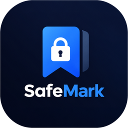

# SafeMark 🔒🔖

**Private bookmarks, sealed with math.** A Chrome & Brave (Manifest V3) extension that stores your
bookmarks in a password-protected, **AES-256-GCM–encrypted** vault opened from a docked side panel.
No account, no server, no telemetry — the encryption key never leaves your head.



## Why

Standard bookmarks sit in your browser profile as plaintext — anyone with file access, a rogue
extension, or stolen disk reads the whole list. SafeMark encrypts every byte before it touches
storage, so what ends up on disk is mathematically useless without your master password.

## Highlights

| | |
|---|---|
| 🔐 **At-rest encryption** | AES-256-GCM; vault stored as ciphertext only — snoop through storage and see gibberish |
| 🧬 **Strong key derivation** | PBKDF2-SHA256, 600,000 iterations → 512-bit key (32-bit verifier + 256-bit AES key) |
| 🚫 **Zero knowledge** | No backend, no analytics, nothing "phones home." 100% auditable source |
| 🧯 **Brute-force shielding** | Rate-limited gate with exponential backoff (up to 60 s) after failed attempts |
| 🖥️ **Docked side panel** | Vault opens beside your browsing — never a pop-out; "Bookmark this page" follows the active tab live |
| ☁️ **Encrypted sync** | Mirrors ciphertext via Chrome/Brave Sync; rev-based merge unites devices without exposing entries |
| 📤 **Never locked in** | One-click export to standard Netscape HTML bookmarks |
| 🍫 **Frosted-glass UI** | Apple-style glassmorphism, dark and calm |

## Install (Chrome / Brave / Edge)

1. Download the latest zip from [Releases](https://github.com/keshavsapra/SafeMark/releases/latest)
2. Unzip it somewhere
3. Visit `chrome://extensions` (or `brave://extensions`) and enable **Developer mode**
4. Click **Load unpacked** → select the unzipped folder
5. Pin the shield, click it, set a master password

> ⚠️ **There is no password recovery — by design.** Anything that could recover your password could
> also be stolen. Forgetting it means the vault is unrecoverable; only reinstalling starts fresh.

## How the crypto works

```
password ──PBKDF2-SHA256(salt, 600k)──► 512-bit master material
                                         ├── bits 0–31+: verifier hash (proves unlock)
                                         └── bits 32–63+: non-extractable AES-256 key

vault JSON ──AES-256-GCM(iv)──► ciphertext ──chunk──► chrome.storage.local
                                └──mirrored──► chrome.storage.sync (ciphertext only)
```

- **Browsing-time decryption only**: the AES key is derived at unlock and lives in memory seconds at a time.
- **Sync carries no secrets**: only salt, verifier, IV, and ciphertext chunks travel; rev-based merging
  unions bookmarks across devices (earliest-added wins for duplicates).
- **Fresh-device adoption**: a new device adopts the synced vault only when its local vault is empty or
  the versions share identity — a foreign vault is never silently adopted over yours.

## Development

```bash
# run the E2E suites (headless Brave via CDP, fresh profile each run)
python3 test_e2e_sync.py    # 29 checks — crypto, sync, migrations
python3 test_e2e_panel.py   # 11 checks — side panel + live tab tracking

# package a release zip
./build.sh                  # → dist/SafeMark-<version>.zip
```

## Homepage

Landing page lives in [`docs/`](docs/) and ships via GitHub Pages:
**https://keshavsapra.github.io/SafeMark/**

## Support

If it's useful to you, consider ☕ [buying me a coffee](https://buymeacoffee.com/ar_kenny).

## License

[MIT](LICENSE)
